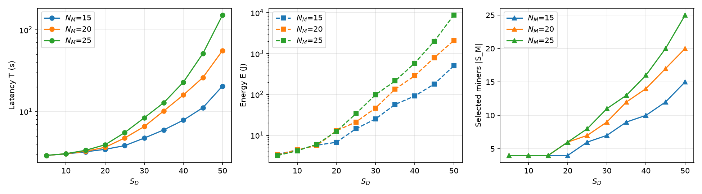

# Energy-Efficient and Latency-Aware Blockchain-Enabled Federated Learning for Edge Networks

> [!NOTE]
> If you use this baseline in your work, please remember to cite the original authors of the paper as well as the Flower paper.

**Paper:** [doi.org/10.1109/TCSII.2023.3322340](https://doi.org/10.1109/TCSII.2023.3322340)

**Authors:** Deepali Kushwaha, Manan Kalavadia, Vinayaka Hegde, Om Jee Pandey

**Abstract:** The introduction of blockchain in federated learning can initiate a federation of trustworthy devices by validating the local model. However, challenges arise due to the blockchain framework's increased latency and energy consumption. This brief proposes a blockchain-enabled federated learning framework that jointly optimizes latency and energy consumption. The proposed method is evaluated over the Google speech commands (GKWS) dataset, suggesting that an optimal set of miners helps reduce forking events by 66.67%, latency by 66.30%, and energy consumption by 82.19%. Experimental results show significant improvement in latency and energy consumption when compared to baseline approaches.


## About this baseline

**What's implemented:** In blockchain-enabled FL, each device uploads its update to a miner. The miners then:
1. cross-verify every update;
2. run proof-of-work for a block holding the aggregated model;
3. propagate the block, which risks accidental forks.

The paper selects which devices, and therefore which miners, take part, so as to minimize the round's latency and energy (Eq. 11, Algorithm 1). This baseline trains a keyword classifier with FedAvg on the selected devices. It reports:
- the selection's blockchain cost (latency, energy, A_fork), against using all devices;
- test accuracy and F1 per round, as in Fig. 3(b).

The `random` selection gives the paper's random baseline (Fig. 4). The cost model and Algorithm 1 come from [`bcfl-optimizer`](https://github.com/v1nayh3g/bcfl-optimizer), the authors' reference implementation. On the exact parameters behind the paper's figures, it selects the same number of miners, with the same A_fork, in all 30 settings of Fig. 3.

**Datasets:** [Google Speech Commands](https://huggingface.co/datasets/google/speech_commands) v0.01 (about 1.5 GB), through Flower Datasets.

**Hardware Setup:** One round with 40 selected devices takes about a minute on 2 CPU cores. Algorithm 1 runs once before the first round, in under a minute for N_M = 15. No GPU is needed.

**Contributors:** Vinayaka Hegde ([@v1nayh3g](https://github.com/v1nayh3g))


## Experimental Setup

**Task:** Keyword spotting (8 classes).

**Model:** The CNN of Sec. IV-A, applied to 32×32 log-magnitude spectrograms:

| Layer | Details |
|---|---|
| Conv2d | 64 filters, 3×3, ReLU |
| GroupNorm, MaxPool | 32 groups; 2×2 |
| Linear | 14,400 → 128, ReLU |
| GroupNorm, Dropout | 32 groups; 0.5 |
| Linear | 128 → 8 (logits) |

**Dataset:**

| Dataset | Keywords | Devices (N_D) | Partitioning | Train / test samples |
|---|---|---|---|---|
| Speech Commands v0.01 | go, stop, left, right, up, down, yes, no | 50 | Dirichlet over labels, α = 0.5, at least 20 samples per device | about 14.8k / 2k |

Each device reports its number of samples D_n to the server before the first round. The
blockchain network is simulated from the paper's Table I. Each device is associated with
one of N_M miners at random, and the hardware and channel parameters are drawn from the
ranges of the paper's simulation (see `DevicePool.random` and `MinerPool.random`).

**Training Hyperparameters:**

| Hyperparameter | Value | Config key |
|---|---|---|
| Rounds | 50 | `num-server-rounds` |
| Devices N_D / miners N_M | 50 / 15 | `num-devices` / `num-miners` |
| Selected devices S_D | 40 | `selected-devices` |
| Selection | Algorithm 1 | `selection` (`bcfl` or `random`) |
| β (latency vs. energy) | 0.5 | `beta` |
| Optimizer, learning rate | Adam, 0.01 | `learning-rate` |
| Local epochs, batch size | 1, 32 | `local-epochs`, `batch-size` |
| Network seed | 42 | `seed` |


## Environment Setup

```bash
# Create the virtual environment
pyenv virtualenv 3.12.12 bcfl-edge

# Activate it
pyenv activate bcfl-edge

# Install the baseline
pip install -e .
```

Decoding the audio requires FFmpeg (`apt install ffmpeg` or `brew install ffmpeg`).


## Running the Experiments

Train on the 40 devices selected by Algorithm 1 (S_D = 80% of N_D, the setting of Sec. V):

```bash
flwr run . --federation-config "num-supernodes=50" --stream
```

Each run writes `outputs/<selection>_sd<S_D>_<time>.json`. The file holds:
- the selected devices and miners;
- the round's latency, energy and A_fork, together with those of using all devices;
- the test loss, accuracy and F1 score after every round.

Compare with random selection, and vary S_D (Fig. 3, Fig. 4):

```bash
flwr run . --federation-config "num-supernodes=50" --run-config "selection='random'"
for sd in 10 20 30 40 50; do
  flwr run . --federation-config "num-supernodes=50" --run-config "selected-devices=$sd"
done
```

### Expected results

The resource side of the paper does not depend on training. Running the reference
implementation on the paper's exact simulation parameters reproduces Fig. 3(a, c):

```bash
git clone https://github.com/v1nayh3g/bcfl-optimizer && cd bcfl-optimizer
pip install -e ".[plot]" && python reproduce/reproduce.py --plot
```



For N_M = 15, selecting 40 of 50 devices instead of all of them reduces:
- forking events by 66.67% (paper: 66.67%);
- latency by 61.77% (paper: 66.30%);
- energy by 81.76% (paper: 82.19%).

The latency reduction is smaller because the reference implementation also models the
miners' verification queuing delay (Eqs. 4–5).
