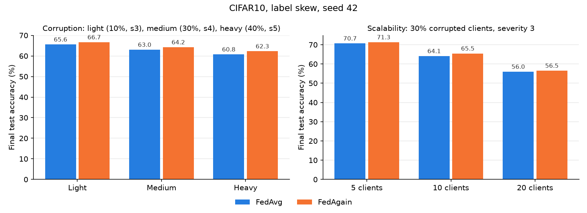
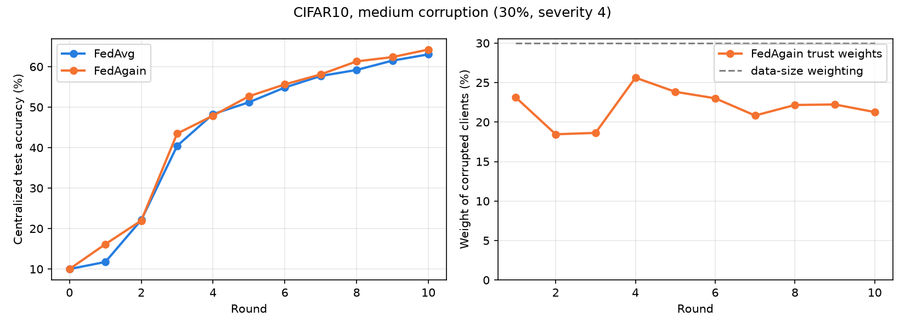
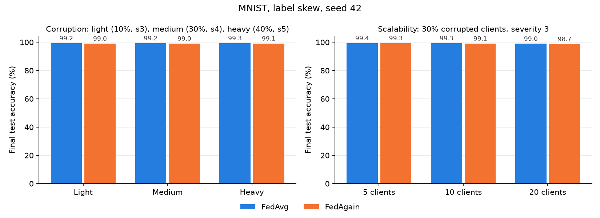
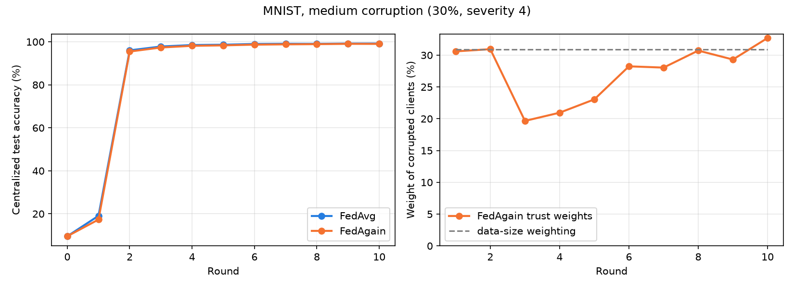

# FedAgain: A Trust-Based and Robust Federated Learning Strategy for an Automated Kidney Stone Identification in Ureteroscopy

> [!NOTE]
> If you use this baseline in your work, please remember to cite the original authors of the paper as well as the Flower paper.

**Paper:** [arxiv.org/abs/2603.19512](https://arxiv.org/abs/2603.19512) (extended version, preprint under review). This baseline implements this version.

**Original FedAgain paper:** Reyes-Amezcua et al., [*Robust Federated Anomaly Detection Using Dual-Signal Autoencoders: Application to Kidney Stone Identification in Ureteroscopy*](https://doi.org/10.1007/978-3-032-08009-7_13), Data Engineering in Medical Imaging (DEMI 2025), MICCAI 2025 Workshop, Daejeon, South Korea, LNCS, Springer, pp. 125–135, 2025 ([arXiv](https://arxiv.org/abs/2510.06230)). In that version the data-quality signal is the reconstruction error of a client-side autoencoder; the extended version replaces it with the benchmark error $E_k$ (validation cross-entropy of the global model), which is what this baseline implements.

**Authors:** Ivan Reyes-Amezcua, Francisco Lopez-Tiro, Clément Larose, Christian Daul, Andres Mendez-Vazquez, Gilberto Ochoa-Ruiz

**Abstract:** The reliability of artificial intelligence (AI) in medical imaging critically depends on its robustness to heterogeneous and corrupted images acquired with diverse devices across different hospitals which is highly challenging. Therefore, this paper introduces FedAgain, a trust-based Federated Learning (FL) strategy designed to enhance robustness and generalization for automated kidney stone identification from endoscopic images. FedAgain integrates a dual trust mechanism that combines benchmark reliability and model divergence to dynamically weight client contributions, mitigating the impact of noisy or adversarial updates during aggregation. The framework enables the training of collaborative models across multiple institutions while preserving data privacy and promoting stable convergence under real-world conditions. Extensive experiments across five datasets, including two canonical benchmarks (MNIST and CIFAR-10), two private multi-institutional kidney stone datasets, and one public dataset (MyStone), demonstrate that FedAgain consistently outperforms standard Federated Learning baselines under non-identically and independently distributed (non-IID) data and corrupted-client scenarios. By maintaining diagnostic accuracy and performance stability under varying conditions, FedAgain represents a practical advance toward reliable, privacy-preserving, and clinically deployable federated AI for medical imaging.


## About this baseline

**What's implemented:** The FedAgain aggregation strategy (Sec. 3.3 and Algorithm 2 of the paper) using the Flower Message API, and the experiments on the public benchmarks of Sec. 6.6 / Fig. 11: FedAgain vs. FedAvg on CIFAR-10 and MNIST under label-skew partitioning, (i) with increasing corruption (light, medium and heavy) and (ii) with 5, 10 and 20 clients. FedMedian, also used in the paper, is available as a third strategy. The kidney stone experiments are not included because two of those datasets are private.

**Datasets:** CIFAR-10 and MNIST, downloaded and partitioned with [Flower Datasets](https://flower.ai/docs/datasets/) (`uoft-cs/cifar10` and `ylecun/mnist` on Hugging Face, both under 200 MB).

**Hardware Setup:** The results below were obtained on a laptop with an Apple M5 Pro (15 CPU cores, 24 GB of unified memory), running the ClientApps on the Apple GPU (MPS) with 5 concurrent ClientApps. A 10-round run with ResNet-18 takes 7 to 13 minutes on CIFAR-10 and 7 to 9 minutes on MNIST (about 4 hours for the 24 runs below). Any machine with 16 GB of RAM can run the experiments; with CPU only expect several times longer. On an NVIDIA GPU, use `GPUS_PER_CLIENT=0.2 ./run_experiments.sh` to share one GPU among five ClientApps.

**Contributors:** Ivan Reyes-Amezcua (CINVESTAV), Francisco Lopez-Tiro, Clément Larose, Christian Daul, Andres Mendez-Vazquez, Gilberto Ochoa-Ruiz


## Experimental Setup

**Task:** Image classification with some clients holding corrupted images (simulated degraded acquisition devices).

**FedAgain in a nutshell.** In round $t$, each client $k$ first evaluates the received global model $W^{(t)}$ on its own validation set and reports the **benchmark error** $E_k^{(t)}$, the mean cross-entropy, computed before any local training (Eq. 6). It then trains locally and returns its model $W_k^{(t+1)}$. The server computes the **parameter divergence** $D_k^{(t)} = \lVert W_k^{(t+1)} - W^{(t)} \rVert_2$ (Eq. 7) and aggregates with normalized trust weights:

$$
T_k^{(t)} = \frac{1}{E_k^{(t)} D_k^{(t)} + \varepsilon}, \qquad
\hat T_k^{(t)} = \frac{T_k^{(t)}}{\sum_j T_j^{(t)}}, \qquad
W^{(t+1)} = \sum_k \hat T_k^{(t)}\, W_k^{(t+1)} .
$$

Clients whose data the global model explains poorly (high $E_k$) or whose update moves far from the global model (high $D_k$) receive less weight. No clean data is needed on the server and the number of corrupted clients does not need to be known. The client data size is not used in the weights.

| File | Content |
| --- | --- |
| `fedagain/strategy.py` | `FedAgain` strategy (subclass of Flower's `FedAvg`) and the trust computations |
| `fedagain/client_app.py` | `ClientApp`: computes $E_k$ before local training and sends it as the `benchmark-error` metric |
| `fedagain/server_app.py` | `ServerApp`: builds the strategy, evaluates the global model on the clean test set and saves the results |
| `fedagain/dataset.py` | Partitioning (IID, Dirichlet, label skew), selection of corrupted clients and their corruption |
| `fedagain/corruptions.py` | Common image corruptions (noise, blur, contrast, brightness, pixelation) |
| `fedagain/model.py` | ResNet-18, a small CNN, local training and evaluation |
| `fedagain/plot.py` | Figures and results table of this README |

**Model:** ResNet-18 trained from scratch (the architecture used in the paper). Since the inputs are 28x28 or 32x32 images, the ImageNet stem is replaced by a 3x3 stride-1 convolution without max-pooling, the usual CIFAR variant. A small CNN (`model="cnn"`) is available for quick tests.

**Dataset:**

| Dataset | Classes | Train / test | Clients | Partitioning | Local validation |
| --- | ---: | ---: | ---: | --- | --- |
| CIFAR-10 | 10 | 50,000 / 10,000 | 5, 10 or 20 | label skew | 10% of each client's partition |
| MNIST | 10 | 60,000 / 10,000 | 5, 10 or 20 | label skew | 10% of each client's partition |

* **Label skew** (Sec. 5.2.2, Eq. 13): client $k$ has two primary classes $\{2k, 2k+1\} \bmod 10$. 80% of the samples of a class are split evenly among the clients for which it is primary, and the remaining 20% among all other clients. IID (`partitioning="iid"`) and Dirichlet (`partitioning="dirichlet"`, `dirichlet-alpha=0.5`) partitioning are also available.
* **Corrupted clients** (Secs. 5.1.4 and 5.3): a fraction $\rho$ of the clients (`corrupted-fraction`) is selected with the run seed, rounding $\rho K$ to the nearest integer (with 5 clients and $\rho = 0.3$, 2 clients are corrupted). Each image of a corrupted client receives one corruption drawn at random, at the given severity.
* The global model is always evaluated on the **clean** test split, on the server.

**Training Hyperparameters:** The defaults in `pyproject.toml` follow Sec. 5.1 of the paper.

| Parameter | Default | Description |
| --- | --- | --- |
| `strategy` | `fedagain` | `fedagain`, `fedavg` or `fedmedian` |
| `epsilon` | `1e-3` | $\varepsilon$ in $T_k$ (Algorithm 2) |
| `num-server-rounds` | `10` | Communication rounds $R$ |
| `fraction-train` | `1.0` | All clients participate in every round |
| `model` | `resnet18` | `resnet18` or `cnn` |
| `local-epochs` | `1` | Local epochs $E$ |
| `batch-size` | `32` | Local batch size |
| `learning-rate` | `0.01` | SGD learning rate |
| `momentum` | `0.9` | SGD momentum |
| `dataset` | `cifar10` | `cifar10` or `mnist` |
| `partitioning` | `label-skew` | `iid`, `dirichlet` or `label-skew` |
| `label-skew-classes` / `label-skew-primary-share` | `2` / `0.8` | Primary classes per client and their share of the data |
| `val-ratio` | `0.1` | Local validation share, used for $E_k$ |
| `corrupted-fraction` | `0.3` | Fraction of corrupted clients $\rho$ |
| `corruption-severity` | `3` | Severity in $[1, 5]$ |
| `corruption-ratio` | `1.0` | Share of the images of a corrupted client that are corrupted |
| `corruption-types` | `all` | Comma-separated subset of the corruptions in `corruptions.py` |
| `seed` | `42` | Seed for partitioning, corruption and training |

### Implementation notes

* **$D_k$ is computed on floating-point tensors only.** ResNet-18 has BatchNorm layers whose integer `num_batches_tracked` counters grow by the number of local mini-batches. Including them in the L2 norm would make $D_k$ measure the size of the local dataset instead of the deviation of the update. Integer buffers are still aggregated (rounded weighted average).
* **Corruptions.** `fedagain/corruptions.py` re-implements in PyTorch eight of the corruptions of Table 3 of the paper (Gaussian, shot, impulse and speckle noise, Gaussian blur, contrast, brightness and pixelation) with the severity constants of the CIFAR-10-C generation script of [Hendrycks & Dietterich (2019)](https://github.com/hendrycks/robustness). They are applied in $[0, 1]$ pixel space, before normalization. The remaining corruptions (glass, motion and zoom blur, weather effects, elastic, JPEG) need extra dependencies and are not included.
* **Corruption of the local validation set.** The corruption is applied to the whole partition of a corrupted client before it is split into local training and validation sets. A hospital with a degraded device validates on degraded images too, which is what makes $E_k$ informative.
* **Results file.** Each run writes a JSON file to `output-dir` with the configuration, the test accuracy and loss per round, and, for FedAgain, $E_k$, $D_k$, $T_k$ and $\hat T_k$ of every client in every round.


## Environment Setup

```bash
# Create the virtual environment
pyenv virtualenv 3.12.12 fedagain

# Activate it
pyenv activate fedagain

# Install the baseline
pip install -e .
```

No extra step is needed: Flower Datasets downloads CIFAR-10 and MNIST on first use.


## Running the Experiments

To run FedAgain with the default configuration (CIFAR-10, 10 clients, 30% corrupted clients, severity 3):

```bash
flwr run . --stream --federation-config "num-supernodes=10"
```

You can override any setting, for example to compare with FedAvg on MNIST with half of the clients corrupted:

```bash
flwr run . --stream --federation-config "num-supernodes=10" \
  --run-config "strategy='fedavg' dataset='mnist' corrupted-fraction=0.5"
```

### Fig. 11: corruption level and number of clients

`run_experiments.sh` runs FedAvg and FedAgain on the six scenarios of Fig. 11 of the paper and then generates the figures and the table below:

| Scenario | Clients | Corrupted clients | Severity |
| --- | ---: | ---: | ---: |
| Light | 10 | 10% | 3 |
| Medium | 10 | 30% | 4 |
| Heavy | 10 | 40% | 5 |
| Scalability | 5, 10, 20 | 30% | 3 |

```bash
./run_experiments.sh cifar10   # 12 runs
./run_experiments.sh mnist     # 12 runs

# Add FedMedian to the comparison
STRATEGIES="fedavg fedmedian fedagain" ./run_experiments.sh cifar10
```


## Results

The results below come from a **single seed** (42), obtained with:

```bash
./run_experiments.sh cifar10 42
./run_experiments.sh mnist 42
```

Accuracy is the accuracy of the global model on the clean test split after 10 rounds. The last column is the share of the aggregation weight that FedAgain gives to the corrupted clients in the last round, next to the share they would receive with the data-size weighting of FedAvg. The tables are printed by `python -m fedagain.plot --dataset <dataset>`.

### CIFAR-10

| Scenario | Clients | Corrupted | Severity | FedAvg | FedAgain | Weight of corrupted clients (FedAgain / data-size) |
| --- | ---: | ---: | ---: | ---: | ---: | --- |
| Light | 10 | 10% | 3 | 65.60 | 66.68 | 7.9% / 10.0% |
| Medium | 10 | 30% | 4 | 63.04 | 64.24 | 21.3% / 30.0% |
| Heavy | 10 | 40% | 5 | 60.77 | 62.28 | 24.2% / 40.0% |
| 5 clients | 5 | 30% | 3 | 70.69 | 71.31 | 35.8% / 40.0% |
| 10 clients | 10 | 30% | 3 | 64.11 | 65.46 | 24.4% / 30.0% |
| 20 clients | 20 | 30% | 3 | 56.00 | 56.53 | 27.4% / 30.0% |





FedAgain is more accurate than FedAvg in the six scenarios, by 0.5 to 1.5 points, and gives the corrupted clients less weight than data-size weighting in all of them. The reduction is largest under heavy corruption (24% of the weight instead of 40%). It comes mostly from the benchmark error: in the last round of the 10-client scenarios the corrupted clients have a mean $E_k$ of 1.20 to 1.54, against 1.00 to 1.02 for the clean clients, while $D_k$ is similar in both groups except at severity 5. The gap is smaller with 5 and 20 clients (0.6 and 0.5 points), and with 20 clients (about 2,250 training images per client) both strategies lose accuracy.

### MNIST

| Scenario | Clients | Corrupted | Severity | FedAvg | FedAgain | Weight of corrupted clients (FedAgain / data-size) |
| --- | ---: | ---: | ---: | ---: | ---: | --- |
| Light | 10 | 10% | 3 | 99.24 | 98.99 | 4.6% / 10.4% |
| Medium | 10 | 30% | 4 | 99.23 | 99.03 | 32.7% / 30.9% |
| Heavy | 10 | 40% | 5 | 99.33 | 99.07 | 31.6% / 40.4% |
| 5 clients | 5 | 30% | 3 | 99.35 | 99.32 | 10.7% / 38.8% |
| 10 clients | 10 | 30% | 3 | 99.26 | 99.07 | 46.8% / 30.9% |
| 20 clients | 20 | 30% | 3 | 98.96 | 98.73 | 14.7% / 29.8% |





On MNIST both strategies reach 98.7% to 99.4% and FedAvg is ahead by 0.03 to 0.26 points. With ResNet-18, these corruptions barely affect MNIST: FedAvg still reaches 99.33% with 40% of the clients at severity 5. The benchmark error of the corrupted clients is therefore not consistently higher than that of the clean clients, and the trust weights do not separate the two groups in a consistent way (the weight of the corrupted clients ranges from 4.6% to 46.8%). Since FedAgain does not use the client data sizes, it loses a little accuracy in this setting. The differences on MNIST are small and come from a single seed; we did not measure the variability across seeds.

### Differences with the paper's setup

* Eight of the corruptions of Table 3 are implemented (see Implementation notes), and each image of a corrupted client receives one of them at random.
* ResNet-18 uses the CIFAR stem (3x3 convolution, no max-pooling) and is trained from scratch.
* One seed per configuration.
