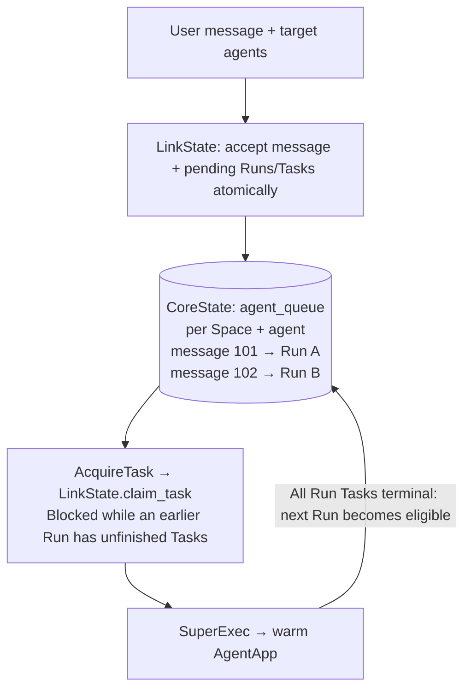

# Agent runs through the existing task queue

Status: orchestration foundation implemented; Control routing remains follow-up work.

# Abstract

The task queue schedules Tasks independently. Messages targeting the same agent
in one Space can therefore start overlapping Runs without following message order.

Add `agent_queue` in CoreState to link user messages to pending Runs. LinkState
accepts messages and targeted work atomically, then gates primary Task claims by
`message_id`. Existing task leases, SuperExec, and warm workers handle execution.

# Motivation

A user can send another message while an agent is busy. We need to accept it
immediately, preserve its input, and execute it after earlier work, even when
multiple workers are acquiring Tasks.

## Goals

- **Ordered execution:** Run messages sequentially per agent and Space, while
  allowing other agents and Spaces to execute concurrently.
- **Atomic acceptance:** Persist the message, targeted Runs/Tasks, queue entries,
  and fixed input together.
- **Reuse execution:** Keep Task and Run schemas, task leases, and warm workers.

## Non-goals

- **Control wiring:** Target routing, endpoint integration, and HTTP request
  idempotency remain follow-up work.
- **New trigger policies:** Automatic execution retries and agent-to-agent triggers.
- **Runtime expansion:** Conversation APIs and full history or memory snapshots.

# Proposal

Create Runs and primary Tasks immediately in PENDING. The queue records their
message order; it does not need a separate status machine or dispatcher.

## Acceptance

`submit_agent_message(state, space_id, flwr_aid, content, targets)` returns the
persisted message and its Run IDs. Each `AgentRunTarget` contains an `agent_id`,
resolved FAB coordinates, and configuration overrides. The caller selects targets
and resolves/stores FABs before entering the submission transaction.

Acceptance checks that the caller and agent participate in the Space and that the
message is authored by the caller. The FAB must match the agent's configured app.
A participant may invoke another member's assigned agent; owning it is not required.

An empty target list publishes only the message. Invalid targets or failed Run
creation roll back the message and every selected execution.

The accepted run stores the exact trigger text as its task input. It records the
FAB hash and configuration at acceptance. Later messages or configuration changes
do not replace that input. This is a trigger snapshot, not a conversation-history
or memory snapshot.

`enqueue_agent_run(state, AgentRunRequest(...))` also supports an existing user
message. Repeating an accepted agent/message pair returns its original Run. A new
assignment to an older message is rejected if a newer message's execution for
that agent/Space has already started or finished. New messages should use the
atomic submission API rather than storing a message and enqueueing later.

## Scheduling contract

| Situation | Behavior |
|---|---|
| Several user messages target the same agent in one Space | Execute by ascending `message_id`; one run executes at a time. |
| Different agents, or the same agent in different Spaces | May execute concurrently. |
| A run starts model or connector tasks | Existing task scheduling applies; child tasks do not acquire another agent slot. |
| The same agent/message pair is submitted again | Return its original run, including after failure; keep the accepted input/configuration. |
| A worker expires before activation | Existing task recovery retries the same queue head. |
| A run completes, fails, or is cancelled | Advance after all its tasks are terminal. No automatic new run or retry. |
| An agent publishes a message | Publication does not trigger agents. Agent-authored triggers are rejected here. |

Queueing applies to runs accepted through this layer. Legacy and unbound Space runs
retain their current behavior. A queue head whose FAB has no available worker
blocks later runs for that agent/Space; workers cannot skip it.
Messages are listed and executions are ordered by the same persisted message ID.
Task timestamps and queue insertion IDs do not affect that order. Different
agents may process the same Space concurrently; there is no Space-wide barrier.

## CoreState changes

- Add `AgentQueueEntry`, the `agent_queue` table, and an Alembic migration.
- Keep Task, Run, and Space schemas and generic Task operations unchanged.

| Column | Purpose |
|---|---|
| `id` | Queue entry identity. |
| `space_id` | Space containing the trigger. |
| `agent_id` | Explicit target agent. |
| `message_id` | User message and execution order. |
| `run_id` | Unique, non-null Run reference without a foreign key. |

- Implement `get_agent_queue_entry(agent_id, message_id)` and
  `create_agent_queue_entry(space_id, agent_id, message_id, run_id)` in
  `InMemoryCoreState` and `SqlCoreState`. These only persist queue assignments.
- Make `(agent_id, message_id)` unique and index
  `(space_id, agent_id, message_id)` for ordered lookup.
- Retain completed entries for deduplication. Repeated assignments return the
  existing entry; conflicting assignments fail. Status comes from Run tasks.
- Lock the Space row before allocating SQL message IDs to preserve commit order.

## LinkState changes

- Implement `submit_agent_message(...)` and `enqueue_agent_run(...)` in
  `InMemoryLinkState` and `SqlLinkState`. Commit the message, pending Runs/Tasks,
  queue entries, and fixed input together.
- Override `claim_task(task_id)`: block a primary Task while an earlier message
  for the same agent/Space has unfinished tasks. Otherwise, use the existing Task
  claim. Check and claim are atomic.
- Submission and claims share the SQL Space-row guard or in-memory
  task/run/Space locks.
- Reuse task leases, failure handling, child-task scheduling, Runtime acquisition,
  and warm workers. No new dispatcher, executor, or protobufs.
- Include prompt objects in the SQL transaction when stores share a session.
  On rollback, clean independent ObjectStores for all created Runs, including
  partial uploads. Crash atomicity across separate stores remains unsupported.

## Follow-up work

- Define routing: explicit target, mentions, or a default agent. Do not assume
  every message targets every participant.
- Wire Control submission to `submit_agent_message` after agreeing on routing.
  Give the public request a durable idempotency key:
  agent/message deduplication alone cannot deduplicate two separately created
  user messages after an HTTP retry.
- Add authorized conversation reads, explicit publication, and any full input
  snapshot/memory behavior in Runtime.
- Define explicit retries and agent-to-agent triggers before enabling them.
