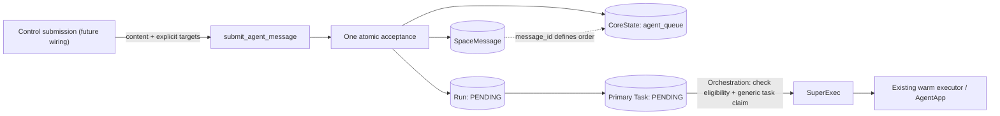

# Agent runs through the existing task queue

Status: orchestration foundation implemented; Control routing remains follow-up work.

Orchestration accepts a user message and explicit agent targets together. It
creates their Runs and primary Tasks immediately in PENDING. A pending Run already
represents accepted work waiting to execute: no separate pre-Run lifecycle,
queue status machine, or dispatcher is needed. Task and Run models stay unchanged.

## Acceptance

`submit_agent_message(state, space_id, flwr_aid, content, targets)` returns the
persisted message and its Run IDs. Each `AgentRunTarget` contains an `agent_id`,
resolved FAB coordinates, and configuration overrides. The caller selects targets
and resolves/stores FABs before entering the submission transaction.

Acceptance checks that the caller and agent participate in the Space and that the
message is authored by the caller. The FAB must match the agent's configured app.
A participant may invoke another member's assigned agent; owning it is not required.

An empty target list publishes only the message. Invalid targets or failed Run
creation roll back the message and every selected execution.

The accepted run stores the exact trigger text as its task input. It records the
FAB hash and configuration at acceptance. Later messages or configuration changes
do not replace that input. This is a trigger snapshot, not a conversation-history
or memory snapshot.

`enqueue_agent_run(state, AgentRunRequest(...))` also supports an existing user
message. Repeating an accepted agent/message pair returns its original Run. A new
assignment to an older message is rejected if a newer message's execution for
that agent/Space has already started or finished. New messages should use the
atomic submission API rather than storing a message and enqueueing later.

## Scheduling contract

| Situation | Behavior |
|---|---|
| Several user messages target the same agent in one Space | Execute by ascending `message_id`; one run executes at a time. |
| Different agents, or the same agent in different Spaces | May execute concurrently. |
| A run starts model or connector tasks | Existing task scheduling applies; child tasks do not acquire another agent slot. |
| The same agent/message pair is submitted again | Return its original run, including after failure; keep the accepted input/configuration. |
| A worker expires before activation | Existing task recovery retries the same queue head. |
| A run completes, fails, or is cancelled | Advance after all its tasks are terminal. No automatic new run or retry. |
| An agent publishes a message | Publication does not trigger agents. Agent-authored triggers are rejected here. |

Queueing applies to runs accepted through this layer. Legacy and unbound Space runs
retain their current behavior. A queue head whose FAB has no available worker
blocks later runs for that agent/Space; workers cannot skip it.
Messages are listed and executions are ordered by the same persisted message ID.
Task timestamps and queue insertion IDs do not affect that order. Different
agents may process the same Space concurrently; there is no Space-wide barrier.

## Persistence and claim

Add a separate `agent_queue` table to CoreState. Task, Run, and Space keep their
existing schemas.

| Column | Purpose |
|---|---|
| `id` | Surrogate identity for the queue entry. |
| `space_id` | Space containing the trigger. |
| `agent_id` | Explicit target agent. |
| `message_id` | Persisted user message and canonical execution order. |
| `run_id` | Non-null, unique reference to the Run created at acceptance. |

The agent/message pair is unique. An index on `(space_id, agent_id, message_id)`
supports ordered lookup. Completed entries remain for deduplication; status comes
from the linked Run's tasks rather than a second status field on the queue.
`run_id` is an execution reference without a foreign key to legacy Run, allowing
CoreState to initialize independently.

CoreState exposes `get_agent_queue_entry(agent_id, message_id)` and
`create_agent_queue_entry(space_id, agent_id, message_id, run_id)`.
These persist queue assignments without creating, modifying, or claiming Tasks.
Repeated assignments return their existing entry; conflicting assignments fail.

Every SQL message writer takes a brief write guard on the existing Space row
before allocating the message ID. Submission holds that guard through message,
queue, Run, Task, and input creation until commit. This prevents a later submission
from becoming visible before the earlier message's work is recorded.

Primary-task claims take the same guard. LinkState checks whether queue entries
with a lower `message_id` for that agent/Space have unfinished tasks, then calls
the unchanged generic Task claim in that transaction. In memory, submission and
claim share task/run/Space locks. Child tasks use normal scheduling.

Task has no queue fields and CoreState's generic Task operations do not consult
`agent_queue`. Queue persistence and worker-task lifecycle remain separate.

Existing task leases, failure handling, Runtime acquisition, and warm workers are
reused. No new scheduler process, executor, or Control/Runtime protobuf is needed.

The queue entry, Run, primary Task, and prompt metadata commit together.
When ObjectStore shares the SQL session, prompt objects join that transaction.
Independent ObjectStores are cleaned up for every created Run, including a Run
whose input upload failed partway through. Crash atomicity across separate stores
is not provided by this change.

## Follow-up work

- Define routing: explicit target, mentions, or a default agent. Do not assume
  every message targets every participant.
- Wire Control submission to `submit_agent_message` after agreeing on routing.
  Give the public request a durable idempotency key:
  agent/message deduplication alone cannot deduplicate two separately created
  user messages after an HTTP retry.
- Add authorized conversation reads, explicit publication, and any full input
  snapshot/memory behavior in Runtime.
- Define explicit retries and agent-to-agent triggers before enabling them.
